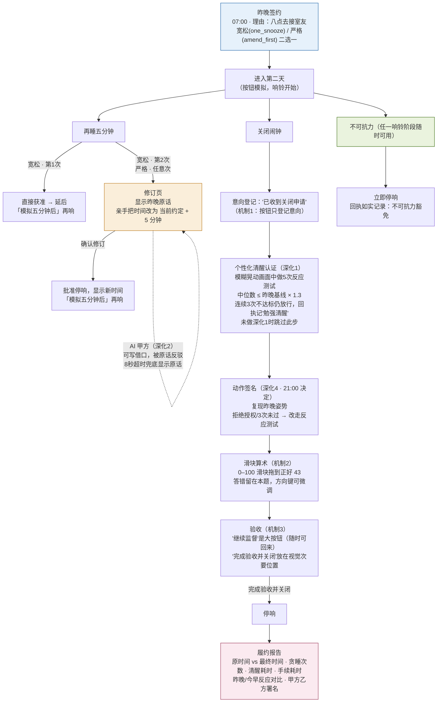

# 双合同分支草图（成员 4 交付 · 对齐 17:30 验收第一项）

> 用途：让全队 4 个人对"第一次贪睡、第二次贪睡、直接关铃"三个结果说法一致（WAKE_CONTRACT_PLAN 时间表第一行的通过条件）。
> 演示固定数据：起床时间 07:00，理由"八点去接室友"，算术题 17＋26＝43。

## 三条路径的口径速查（验收对照）

| 操作 | 宽松合同 | 严格合同 |
| --- | --- | --- |
| 第 1 次按"再睡五分钟" | 直接获准，延后 5 分钟 | 进入修订页，看到昨晚原话 |
| 第 2 次按"再睡五分钟" | 进入修订页 | 进入修订页 |
| 按"关闭闹钟" | 意向登记 →（清醒认证）→ 滑块 → 验收 → 停响 → 回执 | 同左 |
| 按"不可抗力" | 立即停响，回执记豁免 | 同左 |
| 修订时的目标时间 | 当前约定时间 + 5 分钟，其他值无效 | 同左 |
